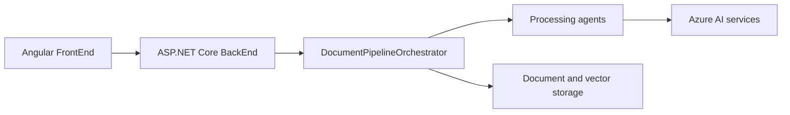

# Automated Multilingual Research Submission Processor

An agentic AI application for processing multilingual research submissions. The system combines an Angular interface, an ASP.NET Core API, Azure AI services, and specialised processing agents for document ingestion, extraction, validation, retrieval, and reviewer-facing workflows.

## Problem statement

Research submissions can arrive as PDF, Word, and scanned documents in different languages. Reviewing them manually for required sections, extracted metadata, language handling, and policy concerns is time-consuming and inconsistent.

## Key capabilities

- Document ingestion and preprocessing, including OCR support for scanned content.
- Language analysis and translation workflows.
- Structured metadata extraction for research documents.
- Validation, content-safety, plagiarism-related, summary, and question-answering agents.
- Retrieval-augmented question answering over processed content.
- Health endpoint and Swagger/OpenAPI documentation in the Development environment.

## Architecture

The backend coordinates specialised agents through `DocumentPipelineOrchestrator`. Agents use configured Azure OpenAI, Azure AI Language, and Azure AI Content Safety services when those integrations are configured.



See [architecture documentation](docs/architecture.md) for component responsibilities, data flow, and security notes.

## Technology stack

- **Frontend:** Angular 15, TypeScript, HTML, CSS
- **Backend:** ASP.NET Core 8, C#
- **AI:** Microsoft Semantic Kernel, Azure OpenAI, Azure AI Language, Azure AI Content Safety
- **Document processing:** Tesseract, PdfPig, Open XML SDK, NPOI

## Repository structure

```text
.
├── BackEnd/                  # ASP.NET Core API and processing pipeline
├── FrontEnd/                 # Angular application
├── docs/                     # Architecture and project material
├── tests/                    # Test strategy and future test projects
└── ResearchSubmissionProject.sln
```

## Prerequisites

- .NET 8 SDK
- Node.js 18 or later and npm
- Azure resources for Azure OpenAI, Azure AI Language, and Azure AI Content Safety

## Run locally

### Configure the backend

Update `BackEnd/appsettings.json` with your own local Azure resource values. The repository contains placeholders; do not commit live credentials.

```bash
dotnet restore BackEnd/BackEnd.csproj
dotnet run --project BackEnd/BackEnd.csproj
```

Swagger UI is available when the backend runs in the Development environment.

### Run the frontend

```bash
cd FrontEnd
npm install
npm start
```

The Angular development server runs on `http://localhost:4200`.

## API

Use the health endpoint to confirm that the service is running:

```bash
curl https://localhost:<port>/api/health
```

Explore document-processing endpoints through Swagger UI in the Development environment.

## Testing

```bash
dotnet build BackEnd/BackEnd.csproj

cd FrontEnd
npm run build
npm test
```

The repository includes test guidance in `tests/`; a dedicated .NET test project is a planned improvement.

## Security and limitations

- Keep API keys and deployment-specific configuration in environment variables, .NET User Secrets, or a managed secret store.
- The development CORS configuration permits `http://localhost:4200`; production deployments should use explicit trusted origins.
- OCR quality depends on the source document and local OCR configuration.
- Azure-backed operations require valid credentials and access to the configured Azure resources.

## Author

Abhishek Kumar
