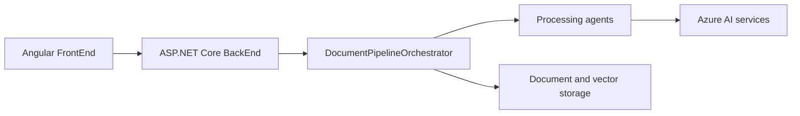

# Automated Multilingual Research Submission Processor

An agentic AI application for processing multilingual research submissions. It combines an Angular interface, an ASP.NET Core API, Azure AI services, and specialised document-processing agents.

## Key capabilities

- Ingestion and preprocessing of research documents, including OCR support.
- Language analysis and translation workflows.
- Structured metadata extraction and document validation.
- Content-safety, plagiarism-related, summary, and question-answering agents.
- Retrieval-augmented question answering over processed content.
- Health endpoint and Swagger/OpenAPI documentation in Development.

## Architecture



See [architecture documentation](docs/architecture.md) for the component responsibilities, data flow, and security notes.

## Technology stack

- **Frontend:** Angular 15, TypeScript, HTML, CSS
- **Backend:** ASP.NET Core 8, C#
- **AI:** Microsoft Semantic Kernel, Azure OpenAI, Azure AI Language, Azure AI Content Safety
- **Document processing:** Tesseract, PdfPig, Open XML SDK, NPOI

## Repository structure

```text
.
├── BackEnd/                  # ASP.NET Core API and processing pipeline
├── FrontEnd/                 # Angular application
├── docs/                     # Architecture and project material
├── tests/                    # Test strategy and future test projects
└── ResearchSubmissionProject.sln
```

## Run locally

### Backend

Configure `BackEnd/appsettings.json` with your own local Azure resource values. The repository contains placeholders; never commit live credentials.

```bash
dotnet restore BackEnd/BackEnd.csproj
dotnet run --project BackEnd/BackEnd.csproj
```

### Frontend

```bash
cd FrontEnd
npm install
npm start
```

The Angular development server runs on `http://localhost:4200`. Swagger UI is available when the backend runs in the Development environment.

## API and testing

```bash
curl https://localhost:<port>/api/health

dotnet build BackEnd/BackEnd.csproj
cd FrontEnd && npm run build && npm test
```

The repository includes test guidance in `tests/`; a dedicated .NET test project remains a planned improvement.

## Security and limitations

- Keep credentials in environment variables, .NET User Secrets, or a managed secret store.
- Restrict the development CORS configuration before production deployment.
- OCR quality depends on document quality and local OCR configuration.
- Azure-backed operations require valid credentials and access to configured resources.

## Author

Abhishek Kumar
