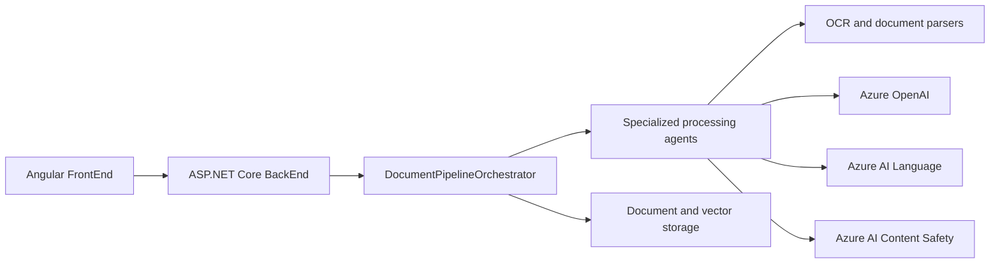

# Architecture

## System overview

## Component responsibilities

- **FrontEnd** provides the Angular user interface.
- **BackEnd** exposes HTTP endpoints, a health endpoint, and development-time Swagger documentation.
- **DocumentPipelineOrchestrator** coordinates the document-processing workflow.
- **Agents** perform ingestion, preprocessing, translation, extraction, validation, safety, summaries, retrieval, and question answering.
- **Storage** maintains document and vector-store abstractions used during processing and retrieval.

## Data flow

1. A client sends a document request to the API.
2. The pipeline coordinates the relevant processing agents.
3. OCR and document libraries extract text where needed.
4. Azure-backed services are used for language, model, and safety operations when configured.
5. Processed document data and vectors are stored for later retrieval and Q&A.

## Security and operational notes

- Keep Azure credentials outside source control; use environment variables, .NET User Secrets, or a managed secret store.
- The development CORS policy currently allows `http://localhost:4200`; production deployments should use explicit trusted origins.
- API configuration must be reviewed before deployment because external-service availability and cost depend on the configured Azure resources.
